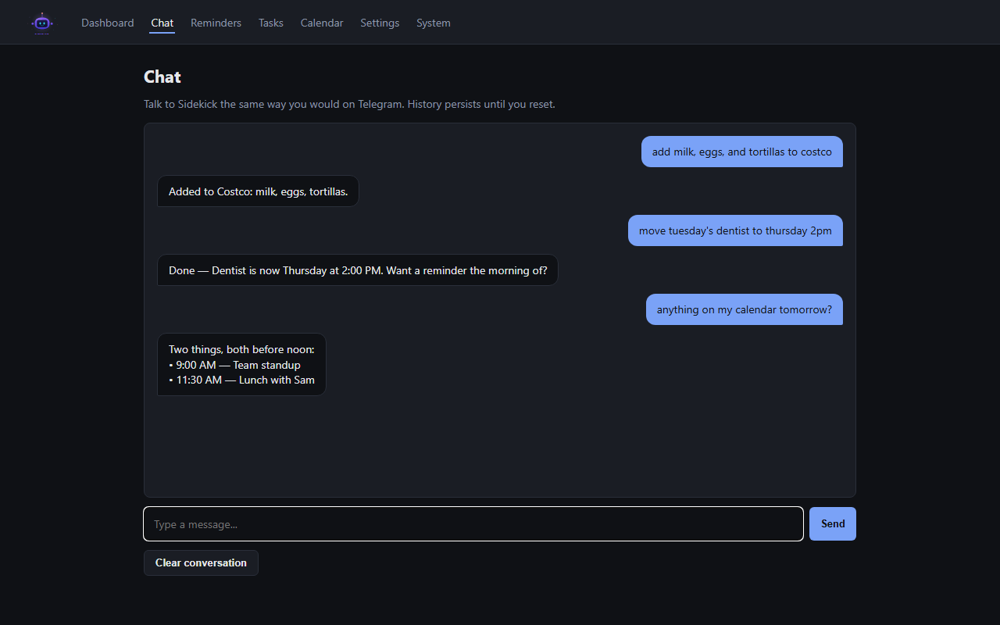
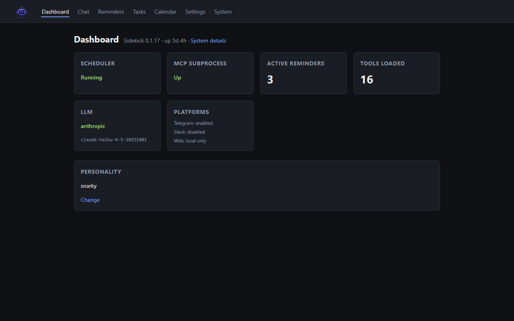
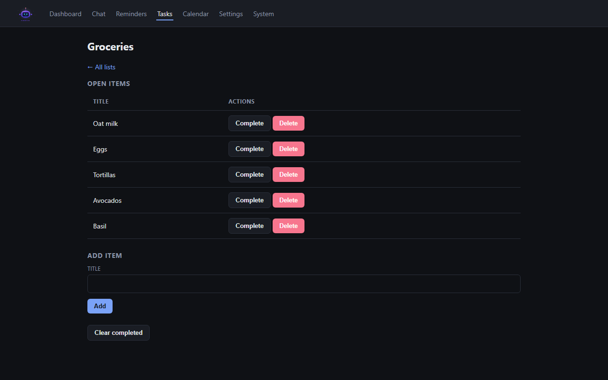
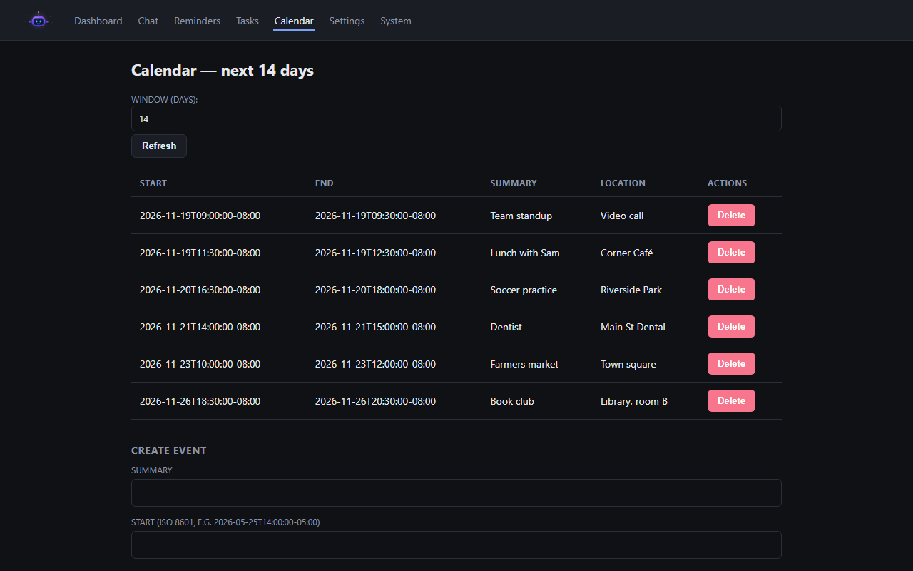
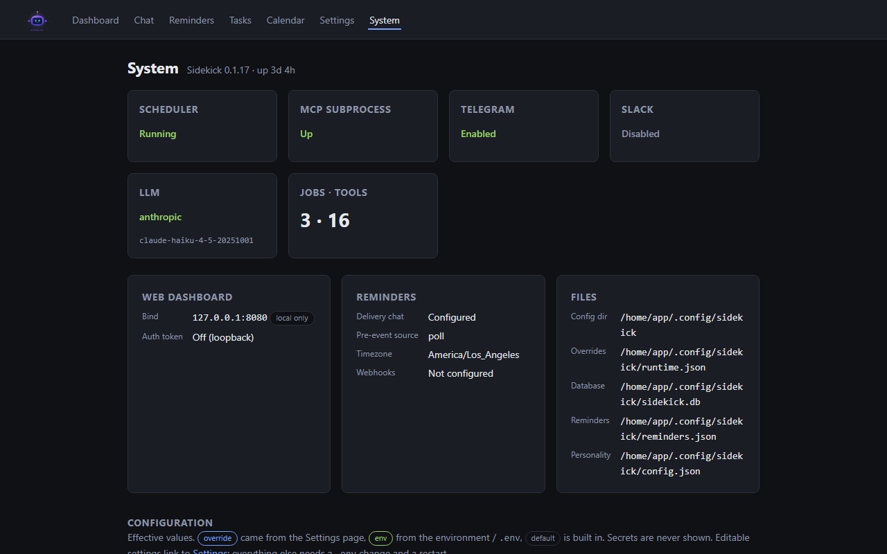

<p align="center">
  
</p>

<p align="center">
  <strong>The AI assistant you text like a friend.</strong><br>
  Calendar, lists, and reminders — in your browser, on Telegram, or on Slack. Powered by Claude or a local LLM. Self-hosted.
</p>

<p align="center">
  <a href="examples/01-local-ollama-docker/"></a>
  <a href="FEATURES.md"></a>
  <a href=".github/CONTRIBUTING.md"></a>
  <a href="LICENSE"></a>
</p>

<p align="center">
  <a href="https://github.com/jaypetez/sidekick/actions/workflows/ci.yml"></a>
  
  
  
  
</p>

---

## Try it locally in 5 minutes

The fastest way to see Sidekick is **without** Telegram or an Anthropic key: everything runs in Docker, a local LLM runs on your machine through Ollama, and you chat with it in your browser.

```bash
cp examples/01-local-ollama-docker/.env.example .env
# Edit .env: paste your Chronary key, and set SIDEKICK_WEB_AUTH_TOKEN to a random
# string of 16+ characters (python -c "import secrets; print(secrets.token_urlsafe(32))")

docker compose run --rm --entrypoint sidekick-init sidekick   # one-time Chronary bootstrap
# Paste the printed CHRONARY_AGENT_ID and CHRONARY_CALENDAR_ID into .env

docker compose --profile ollama up -d
docker compose --profile ollama exec ollama ollama pull qwen2.5:14b
# Open http://localhost:8080 and sign in with your token
```

The full walkthrough, with GPU passthrough, smaller models and what to try first, is in [**examples/01-local-ollama-docker/**](examples/01-local-ollama-docker/).

---

## Screenshots

<p align="center">
  <br>
  <em>The in-browser chat: the same agent as Telegram and Slack.</em>
</p>

<p align="center">
  <br>
  <em>Dashboard: health tiles, version, uptime and the active personality.</em>
</p>

<p align="center">
  <br>
  <em>Tasks are shared state: the agent and the dashboard read and write the same SQLite database.</em>
</p>

<p align="center">
  <br>
  <em>Upcoming events from Chronary, with create, edit and delete.</em>
</p>

<p align="center">
  <br>
  <em>The System page: every setting Sidekick reads, its effective value and where it came from. Secrets show only as set or not set.</em>
</p>

> The screenshots are generated from seeded demo data by `scripts/capture_screenshots.py` (needs `pip install playwright && playwright install chromium`; no API keys required).

---

## What it's like to use

Sidekick lives wherever you want to chat with it: the web UI, Telegram, or Slack. Talk to it the way you'd ping a roommate. No slash commands or special grammar required.

```text
you   add milk, eggs, and tortillas to costco
bot   Added to Costco: milk, eggs, tortillas.

you   move tuesday's dentist to thursday 2pm
bot   Done — Dentist is now Thursday at 2:00 PM. Want me to remind you the morning of?

you   what reminders do i have?
bot   Three:
      • morning_summary — every day 7:30 AM
      • pre_event_check — every 5 min (30-min lead)
      • reminder_174… — every Sunday 5:00 PM ("prep lunches")

you   /personality snarky
bot   Personality set to: snarky.

you   anything on my calendar tomorrow?
bot   Two things, both before noon. Look at you, going full morning-person.
      • 9:00 AM — Dentist
      • 11:30 AM — Lunch with Sarah
```

Behind the scenes Claude (or your local model) calls tools that read and write Chronary, write to a local SQLite database, and schedule jobs. You just chat.

---

## What it can do

| Capability | How to ask | Backend |
|---|---|---|
| **Calendar**: list, add, move, delete events | *"add soccer practice tomorrow 4:30pm"* | [Chronary.ai](https://chronary.ai) |
| **Task lists & groceries**: unlimited named lists, partial-title matching | *"add chicken to the grocery list"* / *"got the eggs"* | Local SQLite at `$SIDEKICK_CONFIG_DIR/sidekick.db` |
| **Scheduled reminders**: recurring, cron-style, persisted across restarts | *"remind me every Sunday 5pm to prep lunches"* | APScheduler + `reminders.json` |
| **Morning summary**: daily briefing of the day's events | time set in `.env`, the Settings page, or by chat | Chronary + scheduler |
| **Pre-event alerts**: a heads-up before events start | polled every 5 min, or pushed by Chronary webhooks | Chronary + scheduler |
| **Personality presets**: snarky, formal, pirate, surfer, butler, or freeform | `/personality snarky` | persisted to `config.json` |

---

## How it's built

```
   ┌──────────────── Chat in ─────────────────┐   ┌──── Operate ────┐
   │  Web chat   ┊   Telegram   ┊   Slack     │   │ Dashboard, /api │
   │ (always on) ┊  (optional)  ┊ (optional)  │   │  sidekick-cli   │
   └──────────────────┬───────────────────────┘   └────────┬────────┘
                      │                                    │
                      ▼                                    │
            ┌───────────────────────┐                      │
            │     SidekickAgent     │◄─────────────────────┘
            │ (tool-use loop, per-  │
            │  chat history)        │
            └──┬────────┬────────┬──┘
               │        │        │ reminder tools (in-process)
               ▼        ▼        ▼
       ┌──────────┐ ┌────────────┐ ┌───────────────┐   POST /webhooks/chronary
       │LLMClient │ │    MCP     │ │  APScheduler  │◄── (signed event.reminder
       │Anthropic │ │ subprocess │ │ morning summ. │     pushes, optional)
       │ /Ollama  │ └──┬──────┬──┘ │ pre-event,    │
       └──────────┘    │      │    │ custom jobs   │
                       ▼      ▼    └───────────────┘
              ┌──────────┐ ┌──────────┐
              │ Calendar │ │TaskStore │
              │ Chronary │ │ SQLite   │
              └──────────┘ └──────────┘
```

Everything runs in one Python process on one asyncio event loop, except the MCP server, which is a stdio subprocess serving the 12 calendar and task tools. The four reminder tools run in-process because they need the live scheduler. The web dashboard and its JSON API share that process too.

The calendar, task store and LLM sit behind abstract base classes (`CalendarProvider`, `TaskStore`, `LLMClient`), so adding another backend means one new class plus wiring. Slack implements the `ChatPlatform` ABC; Telegram is still wired directly in `bot.py`.

| Layer | Default | Alternative | Files |
|---|---|---|---|
| LLM | Anthropic Claude | local Ollama (`LLM_PROVIDER=ollama`) | `llm/anthropic.py`, `llm/ollama.py` |
| Calendar | Chronary.ai | — *(write your own)* | `calendar/chronary.py` |
| Tasks | Local SQLite | — *(write your own)* | `storage/sqlite_tasks.py` |
| Chat platforms | Web chat (always) + Telegram + Slack (both opt-in) | WhatsApp-ready ABC, not built | `web/`, `bot.py`, `platforms/slack.py` |

---

## Quickstart

> Want the fully local "no Telegram, no Anthropic key" path? Use [Try it locally in 5 minutes](#try-it-locally-in-5-minutes) above, or [examples/01-local-ollama-docker/](examples/01-local-ollama-docker/) for the full walkthrough. The Quickstart below is the production path with Telegram and Anthropic.

### Option A — Docker (recommended)

```bash
git clone https://github.com/jaypetez/sidekick.git
cd sidekick
cp .env.example .env && chmod 0600 .env
```

Edit `.env`:

- `TELEGRAM_BOT_TOKEN`: from [@BotFather](https://t.me/BotFather). Delete the placeholder value to run web-only.
- `TELEGRAM_ALLOWED_USER_IDS`: uncomment and set it. **Unset means every Telegram message is rejected** (see [Setting up Telegram](#setting-up-telegram)).
- `ANTHROPIC_API_KEY` and `CHRONARY_API_KEY`.
- `REMINDER_CHAT_ID`: optional; fill it in later with `/get_id`.

Then bootstrap Chronary and start the bot:

```bash
# One-time Chronary bootstrap: creates an agent + default calendar.
# --entrypoint is required: the image's entrypoint is the bot itself.
docker compose run --rm --entrypoint sidekick-init sidekick
# Paste the printed CHRONARY_AGENT_ID and CHRONARY_CALENDAR_ID into .env

docker compose up -d
docker compose logs -f sidekick
```

State (database, reminders, personality, settings overrides, secrets) lives in `./data/sidekick` on the host. The container runs as a non-root `app` user, so if Docker created that directory as root, make it writable for the container (for example `sudo chown -R 999:999 data/sidekick`; check the uid with `docker compose run --rm --entrypoint id sidekick`).

To run with a **local LLM** instead of Anthropic:

```bash
# In .env: LLM_PROVIDER=ollama, OLLAMA_BASE_URL=http://ollama:11434, OLLAMA_MODEL=qwen2.5:14b
docker compose --profile ollama up -d
docker compose --profile ollama exec ollama ollama pull qwen2.5:14b
```

The compose file needs **Docker Compose v2.20 or newer** (it uses an optional `depends_on`).

**Pre-built image.** Every release is published to `ghcr.io/jaypetez/sidekick` for **amd64 and arm64** (so a Raspberry Pi 4/5 on a 64-bit OS works), tagged `latest`, `X.Y` and `X.Y.Z`. To use it instead of building locally, point the service at it in a `docker-compose.override.yml`:

```yaml
services:
  sidekick:
    image: ghcr.io/jaypetez/sidekick:0.2   # or :latest
```

Then run `docker compose pull sidekick && docker compose up -d`. A published image already reports its real version in `/version` and on the dashboard. A local build reports `0.0.0` unless you set `SIDEKICK_VERSION` (see the comment in `docker-compose.yml`).

### Option B — bare metal (Python 3.11+)

```bash
git clone https://github.com/jaypetez/sidekick.git
cd sidekick
python -m venv .venv && source .venv/bin/activate     # Windows: .venv\Scripts\activate
pip install -e .                                      # add ".[dev]" to run the tests
cp .env.example .env && chmod 0600 .env               # fill it in, as above

sidekick-init      # creates the Chronary agent + default calendar; paste the IDs into .env
sidekick           # starts the bot
```

---

## Configuration

The settings most people need:

| Variable | Required when | Where to get it |
|---|---|---|
| `TELEGRAM_BOT_TOKEN` | only for Telegram (leave blank for web-only mode) | [@BotFather](https://t.me/BotFather) → `/newbot` |
| `TELEGRAM_ALLOWED_USER_IDS` | whenever Telegram is enabled. **Closed by default: unset = every message rejected** | CSV of numeric user IDs; see [Setting up Telegram](#setting-up-telegram) |
| `LLM_PROVIDER` | optional, default `anthropic` | `anthropic` \| `ollama` |
| `ANTHROPIC_API_KEY` | `LLM_PROVIDER=anthropic` | [console.anthropic.com](https://console.anthropic.com) |
| `CLAUDE_MODEL` | optional, default `claude-haiku-4-5-20251001` | any Claude model ID |
| `OLLAMA_BASE_URL`, `OLLAMA_MODEL` | `LLM_PROVIDER=ollama` | local install, or the compose `ollama` service |
| `CHRONARY_API_KEY` | always | [console.chronary.ai](https://console.chronary.ai) |
| `CHRONARY_AGENT_ID`, `CHRONARY_CALENDAR_ID` | always | printed by `sidekick-init` |
| `TIMEZONE` | optional, default `America/Chicago` | IANA name, e.g. `America/Los_Angeles` |
| `REMINDER_CHAT_ID` | enables morning summary + pre-event alerts | send `/get_id` to the bot in the target chat |
| `MORNING_REMINDER_TIME`, `PRE_EVENT_REMINDER_MINUTES` | optional, defaults `07:30` and `30` | 24-hour `HH:MM`; minutes of lead time |
| `PRE_EVENT_SOURCE`, `CHRONARY_WEBHOOK_ID` | only for push reminders | see [Push reminders from Chronary](#push-reminders-from-chronary-optional) |
| `SLACK_BOT_TOKEN`, `SLACK_APP_TOKEN`, `SLACK_ALLOWED_USER_IDS` | only for Slack (allowlist is closed by default) | see [Adding Slack](#adding-slack) |
| `SIDEKICK_WEB_ENABLED` | optional, default `true` | `false` turns off the dashboard, `/api`, `sidekick-cli` and the webhook route (forced back on in web-only mode) |
| `SIDEKICK_WEB_HOST`, `SIDEKICK_WEB_PORT` | optional, default `127.0.0.1:8080` | bind address for the dashboard |
| `SIDEKICK_WEB_AUTH_TOKEN` | **required** when `SIDEKICK_WEB_HOST` isn't loopback (always in Docker); 16+ characters | any long random string |
| `SIDEKICK_CONFIG_DIR` | optional, default `~/.config/sidekick` | where every state file lives (DB, reminders, personality, settings overrides, secrets) |

[`.env.example`](.env.example) explains each of these plus the rest: rate limits, the Slack channel allowlist, `SIDEKICK_WEB_ALLOWED_HOSTS`, `SIDEKICK_WEB_TRUST_PROXY`, the session secret and per-file path overrides. The **System** page (or `sidekick-cli system config`) lists every setting Sidekick reads, with its effective value and where it came from.

---

## Admin dashboard

Sidekick serves an in-process web UI, by default at **http://127.0.0.1:8080**. It runs on the same event loop as the Telegram and Slack adapters, and when no Telegram token is set it is the only chat surface. The pages:

- **Chat**: talk to the agent in the browser; the same `SidekickAgent` as Telegram and Slack
- **Dashboard**: health tiles (scheduler, MCP, reminder count, tool count, active LLM, platforms), version, uptime and the active personality
- **Reminders**: create, pause, resume or delete; the built-in jobs (morning summary, pre-event check) can be paused but not removed
- **Tasks**: browse every list, add, complete or delete items, clear completed, drop a whole list
- **Calendar**: upcoming events in a configurable window; create, edit and delete events
- **Settings**: switch personality and edit runtime settings: LLM provider and model, Ollama tuning, timezone, morning-summary time, pre-event lead time and pre-event reminder source. Saved changes go to `runtime.json` in the config dir and override `.env`. LLM changes reload the client immediately, reminder settings apply to the live jobs, and a `TIMEZONE` change takes effect after a restart. API keys are write-only (only the last 4 characters are shown). Each field shows where its value comes from (`override`, `from .env`, or `default`), and overrides have a **Reset** button.
- **System**: a read-only view of how this Sidekick is set up: component status, version and uptime, LLM in use, Telegram and Slack state, web bind and auth posture, reminder delivery, file paths, and **every** setting Sidekick reads with its effective value and source. Secrets only ever show as set or not set.
- **Health**: `GET /health` returns JSON for monitoring. When an auth token is set, callers without it only get `{"status": "ok"}`.

**Access.** With the default loopback bind and no token, the dashboard has no login, and it only answers requests whose `Host` is a loopback name (a DNS-rebinding defense). To reach it through another hostname, such as a Tailscale MagicDNS name, add that name to `SIDEKICK_WEB_ALLOWED_HOSTS`, or set `SIDEKICK_WEB_AUTH_TOKEN`. With a token set, opening any page in a browser redirects to a **sign-in form**: paste the token once and the session lasts 7 days. API clients send `Authorization: Bearer <token>` instead. Binding to anything other than loopback **requires** the token; the dashboard refuses to start without one.

**Docker.** Inside a container, `127.0.0.1` is the container's own loopback, so `docker-compose.yml` expects `SIDEKICK_WEB_HOST=0.0.0.0` (which in turn requires `SIDEKICK_WEB_AUTH_TOKEN`). Compose publishes the port only on the host's loopback (`127.0.0.1:8080`), so the dashboard is still not reachable from your LAN. For remote access, use an SSH tunnel (`ssh -L 8080:127.0.0.1:8080 …`) or Tailscale/WireGuard.

**JSON API + CLI.** Everything the dashboard does is also available as JSON under `/api/*` (`{data, error}` envelope), and `sidekick-cli` wraps it for the terminal:

```bash
sidekick-cli tasks list
sidekick-cli events list --days 7
sidekick-cli settings set MORNING_REMINDER_TIME 06:45
sidekick-cli system status
sidekick-cli system config --group LLM
sidekick-cli chat send "what's on tomorrow?"
```

It talks to `http://127.0.0.1:$SIDEKICK_WEB_PORT` (override with `SIDEKICK_API_URL` or `--base-url`; add `--json` for raw output). When the dashboard requires auth, it sends `SIDEKICK_API_TOKEN` as a bearer token, falling back to `SIDEKICK_WEB_AUTH_TOKEN`. `sidekick-cli` reads these from the shell environment, not from `.env`. In Docker the container already has them, so the easiest way is:

```bash
docker compose exec sidekick sidekick-cli system status
```

---

## Setting up Telegram

Telegram needs two settings: a bot token and an allowlist.

1. **Create the bot.** Message [@BotFather](https://t.me/BotFather), send `/newbot`, and follow the prompts (pick a display name, then a username ending in `bot`). BotFather replies with a token like `123456:ABC-DEF…`. Put it in `.env` as `TELEGRAM_BOT_TOKEN`.
2. **Find your user ID.** Message [@userinfobot](https://t.me/userinfobot); it replies with your numeric Telegram user ID.
3. **Allow yourself in.** Set `TELEGRAM_ALLOWED_USER_IDS` to that ID (CSV for several people, e.g. `12345678,98765432`). **This is closed by default: if it's unset or empty, the bot rejects every message,** so this step is not optional. Restart after editing (in Docker, `docker compose up -d sidekick` recreates the container so it picks up the new `.env`).
4. **Start chatting.** Open your bot in Telegram (search for its `@username`) and send `/start`. Then just talk to it.

**Built-in commands:** `/start` (intro), `/reset` (clear conversation history), `/get_id` (print this chat's ID), `/version` (which Sidekick version is running), `/personality <style>` (change tone). You can also just ask it what version it's on.

> The allowlist is keyed on **user** ID, while `REMINDER_CHAT_ID` (below) wants a **chat** ID. In a 1:1 DM with the bot the two are the same, so `/get_id` in your DM gives you the value for both. They differ only in group chats.

### Using it in a group chat

You can run Sidekick in a group instead of (or as well as) a 1:1 DM, which is handy for a household or team. A few things to know:

1. **Add the bot to the group.** Open the group → *Add members* → search for your bot's `@username` and add it.
2. **Decide on group privacy mode.** BotFather bots start with **privacy mode ON**: the bot only sees messages that @mention it, reply to one of its messages, or are commands (`/get_id`, `/start`). When you add it, Telegram shows a *"the bot has no access to messages"* note; that's this setting, and it's expected.
   - **Leave it ON** to have the bot respond only when addressed (`@yourbot what's on my calendar?`). Recommended for busy groups.
   - **Turn it OFF** to have the bot act on *every* message in the group. Sidekick has no mention filter, so with privacy off it replies to everything. That includes members who aren't on the allowlist: each of their messages gets a short "not on this bot's allowlist" reply. To disable it: message [@BotFather](https://t.me/BotFather) → `/setprivacy` → pick your bot → **Disable**. ⚠️ The change only applies to groups the bot joins *after* the switch, so **remove the bot from the group and add it again**.
3. **The allowlist still applies per user.** `TELEGRAM_ALLOWED_USER_IDS` decides *who* may use the bot, even in a group. Add each person's numeric user ID, comma-separated.
4. **The group shares one conversation.** History is kept per chat, so everyone in the group talks to the same running conversation. `/reset` clears it for the whole group.
5. **Point reminders at the group.** Set `REMINDER_CHAT_ID` to the group's chat ID, which is a **negative** number. Get it with `/get_id` in the group, or with the tip below.

> **Tip: get user and chat IDs without running the bot.** Once `TELEGRAM_BOT_TOKEN` is set and the bot is in the chat, post a message the bot can see (with privacy mode on, that means one that @mentions it, or a command), then ask Telegram's API directly:
> ```bash
> curl -s "https://api.telegram.org/bot<YOUR_BOT_TOKEN>/getUpdates" | python -m json.tool
> ```
> In each update, `message.from.id` is a **user ID** (for `TELEGRAM_ALLOWED_USER_IDS`) and `message.chat.id` is the **chat ID** (negative for groups; use it for `REMINDER_CHAT_ID`). Telegram only keeps updates briefly, and returns nothing while the bot itself is running and polling, so stop the bot first and send a fresh message right before you call this.

### Enabling reminders (optional)

Morning summaries and pre-event alerts need a destination chat. Send `/get_id` to the bot in the chat you want them in, set `REMINDER_CHAT_ID` to the value it prints, and restart. Leave it blank to turn reminders off.

**Update announcements.** After you deploy a new version, Sidekick posts to that same chat, once, which version it's now on and what changed since the version it last announced. Features and fixes are listed by name; dependency, docs and CI changes are summarized as a count. The change list comes from GitHub's public compare API, so the bot makes one outbound request per upgrade (no data about you is sent). If GitHub can't be reached, it announces just the version. A plain restart stays quiet. Turn it off with `SIDEKICK_ANNOUNCE_UPDATES=false`, and point it at a fork with `SIDEKICK_UPDATE_REPO=owner/repo`. Local builds need `SIDEKICK_VERSION` set (see *Pre-built image* above) so there's a real version to compare.

### Push reminders from Chronary (optional)

By default Sidekick checks the calendar every 5 minutes for events starting within `PRE_EVENT_REMINDER_MINUTES`. Chronary can instead **push** a signed `event.reminder` webhook at exactly the right time, so there's no polling lag, no midnight blind spot, and no repeats after a restart.

This needs a **public HTTPS URL** that reaches the dashboard's `/webhooks/chronary` route; Chronary refuses private and localhost addresses. A tunnel (Cloudflare Tunnel, Tailscale Funnel, ngrok) or a reverse proxy works. **Expose only that one path.** The route checks Chronary's HMAC signature itself, so it skips the dashboard's login, CSRF and Host checks; everything else on the dashboard should stay private. [Exposing the webhook with Cloudflare Tunnel](#exposing-the-webhook-with-cloudflare-tunnel) below walks through one way to do it.

```bash
sidekick-webhook register --url https://hooks.example.com/webhooks/chronary
# The signing secret is saved (0600) to $SIDEKICK_CONFIG_DIR/chronary_webhook.secret
# and never printed. Paste the printed CHRONARY_WEBHOOK_ID into .env, restart, then
# set "Pre-event reminder source" to "Chronary webhooks" on the Settings page
# (or PRE_EVENT_SOURCE=webhook in .env).
sidekick-webhook test     # sends a signed test reminder through the whole path
sidekick-webhook status   # active? deactivated reason? recent deliveries
```

In Docker, run these inside the running container so they use its config dir: `docker compose exec sidekick sidekick-webhook register --url …`.

`register` also sets the calendar's default reminder to `PRE_EVENT_REMINDER_MINUTES`. The route returns 404 until a signing secret is configured (that file, or `CHRONARY_WEBHOOK_SECRET` to override it). `GET /api/health` reports when the last delivery arrived, so you can tell if the tunnel goes down. To go back to polling, run `sidekick-webhook delete` and set the source back to polling.

### Exposing the webhook with Cloudflare Tunnel

If your domain is on Cloudflare, a remotely managed tunnel gives Sidekick a public HTTPS hostname without opening any ports. These steps assume the Docker setup above and use `hooks.example.com` as the public hostname.

1. **Set Sidekick up for it.** In `.env`, set `SIDEKICK_WEB_HOST=0.0.0.0` (so the tunnel container can reach the dashboard on the compose network) and a `SIDEKICK_WEB_AUTH_TOKEN` (required for that bind). Recreate the container: `docker compose up -d sidekick`.
2. **Create the tunnel.** In the Cloudflare dashboard go to *Zero Trust → Networks → Tunnels → Create a tunnel*, choose **Cloudflared**, and name it. Of the install command it shows, keep only the token (the long `eyJ…` string). Save it on the host in a file outside the repo that only you can read, for example `~/cloudflared/tunnel.env` containing `TUNNEL_TOKEN=eyJ…`, with `chmod 600`.
3. **Run `cloudflared` next to Sidekick.** Create `docker-compose.override.yml` in the repo root. Compose picks it up automatically, and you can list it in `.git/info/exclude` so git ignores it:

   ```yaml
   services:
     cloudflared:
       image: cloudflare/cloudflared:<pinned-version>
       container_name: sidekick-cloudflared
       command: tunnel --no-autoupdate run
       env_file: /home/<you>/cloudflared/tunnel.env
       restart: unless-stopped
   ```

   Run `docker compose up -d`. The tunnel shows as **Healthy** in the dashboard.
4. **Route only the webhook path.** In the tunnel's *Published application routes*, add a route:
   - **Hostname**: `hooks.example.com`
   - **Path**: `^/webhooks/chronary$`
   - **Service**: `http://sidekick:8080` (the compose service name and port)

   Cloudflare creates the DNS record. Any other path falls through to the tunnel's catch-all rule, which returns 404, so the dashboard and sign-in page stay private.
5. **Check it from outside**, then register:

   ```bash
   curl -s -o /dev/null -w '%{http_code}\n' https://hooks.example.com/                    # 404: dashboard not exposed
   curl -s -o /dev/null -w '%{http_code}\n' -X POST https://hooks.example.com/webhooks/chronary   # 401 once a secret exists (404 before)
   docker compose exec sidekick sidekick-webhook register --url https://hooks.example.com/webhooks/chronary
   docker compose exec sidekick sidekick-webhook test
   ```

---

## Adding Slack

Slack is opt-in and runs at the same time as Telegram and the web chat: the same bot with another front door.

1. Create a Slack app at https://api.slack.com/apps.
2. Enable **Socket Mode** and generate an `xapp-…` app-level token.
3. Add the bot token scopes `chat:write`, `im:history`, `im:read` and `im:write`.
4. Under **Event Subscriptions**, enable events and subscribe to the bot event `message.im`, so direct messages reach the bot. To use it in channels as well, also add `channels:history` and `message.channels`, then invite the bot to the channel. It answers every message it receives there; there is no mention filter.
5. Install the app to your workspace and copy the `xoxb-…` bot user token.
6. Set `SLACK_BOT_TOKEN` and `SLACK_APP_TOKEN` in `.env`.
7. Set `SLACK_ALLOWED_USER_IDS` to the Slack member IDs (like `U01ABC23DEF`) allowed to use the bot. **Closed by default: if it's unset, every Slack message is rejected.** Optionally, `SLACK_ALLOWED_CHANNELS` limits which channels it responds in.
8. Restart.

Conversation history is kept per chat. Slack chats use an `sl:<channel>` key, so they never collide with Telegram chat IDs.

> Heads up: morning summaries and pre-event reminders currently fire only on Telegram. Multi-platform reminder delivery is a tracked follow-up.

---

## Local LLM (Ollama)

Set `LLM_PROVIDER=ollama` to send requests to a local Ollama server instead of Anthropic. The provider, model and Ollama tuning (`OLLAMA_NUM_CTX`, `OLLAMA_NUM_GPU`, `OLLAMA_KEEP_ALIVE`) can also be changed on the Settings page without a restart.

**Recommended tool-capable models:**

| Model | VRAM (Q4) | Notes |
|---|---|---|
| `qwen2.5:14b` | ~9GB | **Best tool use we tested at ≤16GB VRAM.** Default in [examples/01](examples/01-local-ollama-docker/). |
| `qwen2.5:7b` | ~5GB | Smaller GPUs or CPU-only. Slightly better at function calling than llama3.1:8b. |
| `llama3.1:8b` | ~5GB | The project's historical baseline and the `.env.example` default. |

> ⚠️ Tool-use reliability on any local model is **materially lower** than Claude's. For day-to-day use, keep Anthropic. Ollama is for offline, cost-free or privacy-sensitive operation where the occasional missed tool call is acceptable.

For NVIDIA GPU passthrough in Docker, layer `docker-compose.gpu.yml` on top: `docker compose -f docker-compose.yml -f docker-compose.gpu.yml --profile ollama up -d`.

---

## Deployment posture

Sane defaults out of the box, but you own the host. Specifics worth knowing:

- **The web dashboard binds to `127.0.0.1` by default** on bare metal. In Docker it binds `0.0.0.0` *inside* the container, which requires `SIDEKICK_WEB_AUTH_TOKEN`, and compose publishes it only on the host's loopback (`127.0.0.1:8080`), so it isn't reachable from the LAN.
- **Ollama's port is loopback-only.** The compose file binds the `ollama` service to `127.0.0.1:11434`, so a misconfigured firewall doesn't expose your model server to the network.
- **`.env` should be `chmod 0600`.** It holds bot tokens, Chronary keys and Anthropic credentials.
- **State files with secrets or schedules are written with mode `0600`**: `reminders.json`, `runtime.json` (which can hold an API key entered on the Settings page), `web_session.secret` and `chronary_webhook.secret`.
- **The MCP subprocess gets a scoped environment**: only the Chronary credentials, the database and config paths, the timezone, and basic process variables such as `PATH`. Telegram, Slack, Anthropic and web-auth tokens are withheld.
- **Chat is rate-limited per user** on Telegram, Slack and web chat (`SIDEKICK_RATE_LIMIT_MAX` per `SIDEKICK_RATE_LIMIT_WINDOW_SECONDS`, default 10 per 60 s).
- The full hardening guide is in [`docs/security.md`](docs/security.md).

---

## Known limitations

- **Recurring events**: Sidekick doesn't create recurring series in Chronary. Asked for *"every X"*, it creates individual events. Instances of recurring series that already exist in Chronary are listed with their series ID.
- **`location` and `attendees` on events** are stored in Chronary's `metadata` field (they aren't first-class fields). They round-trip correctly on list and get.
- **Reminders are Telegram-only** for now, so they don't fire in web-only mode.
- **WhatsApp is not built.** The `ChatPlatform` abstraction is ready for another adapter; there's just no implementation yet.

---

## Development

```bash
pip install -e ".[dev]"
pytest                                     # full suite with the 80% coverage gate
pytest --no-cov                            # faster when iterating locally
pytest tests/test_storage_tasks.py -v      # one file
ruff check . && ruff format --check .      # lint + format check (CI gates these)
mypy src/sidekick                          # strict type check (CI gates this)
```

Tests make no live API calls; everything is mocked. CI runs lint, type checking and tests on Python 3.11 and 3.12, plus dependency review; all five jobs must pass before a PR can merge. Separate workflows also run `pip-audit`, `bandit` and CodeQL.

Branching, commit and PR conventions are in [`.github/CONTRIBUTING.md`](.github/CONTRIBUTING.md). `main` is protected (CODEOWNERS review, linear history, no force-push): work happens on `feat/`, `fix/`, `docs/` and `chore/` branches and lands through a PR. Contributors using AI coding agents should start with [`CLAUDE.md`](CLAUDE.md).

---

## License

[MIT](LICENSE).

---

## Security

Sidekick is a single-tenant, self-hosted bot. Defaults are closed: Telegram and Slack require explicit user allowlists, the web dashboard binds to `127.0.0.1:8080` and requires a token for any other bind, and CI runs `pip-audit`, `bandit` and CodeQL on every PR.

- Policy and how to report a vulnerability: [`.github/SECURITY.md`](.github/SECURITY.md)
- Operator's guide (threat model, surface posture, checklist, known limitations): [`docs/security.md`](docs/security.md)
